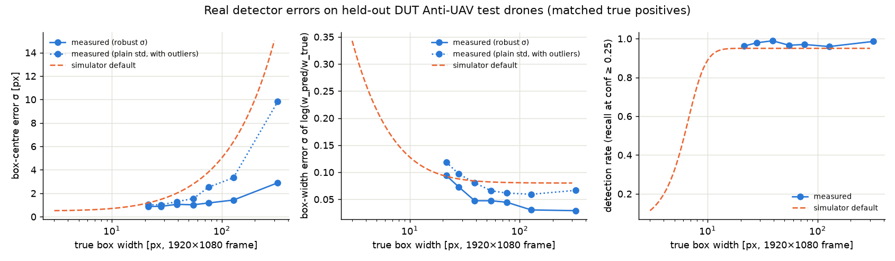
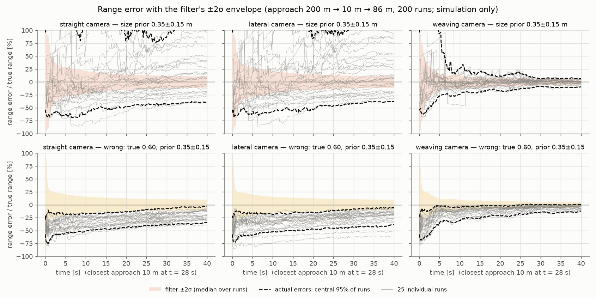
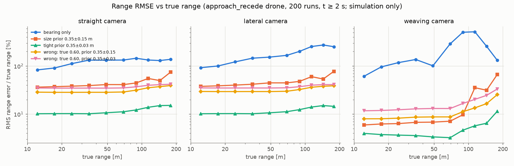
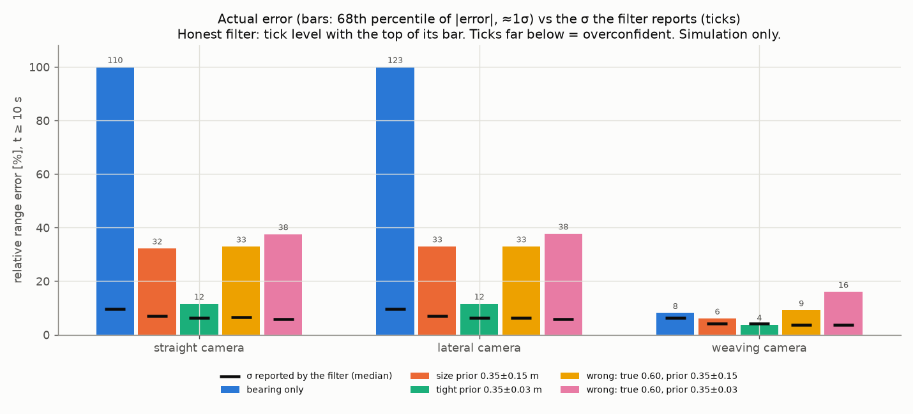
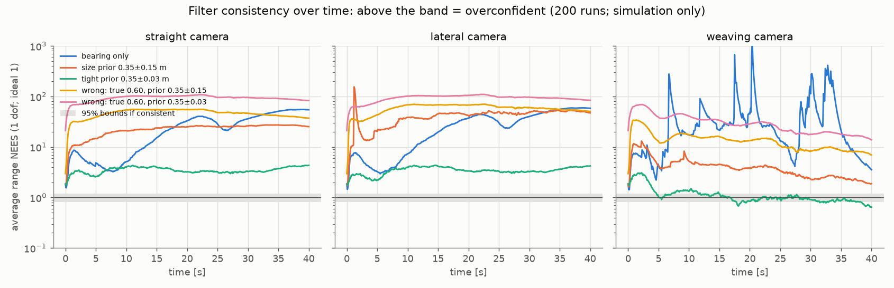
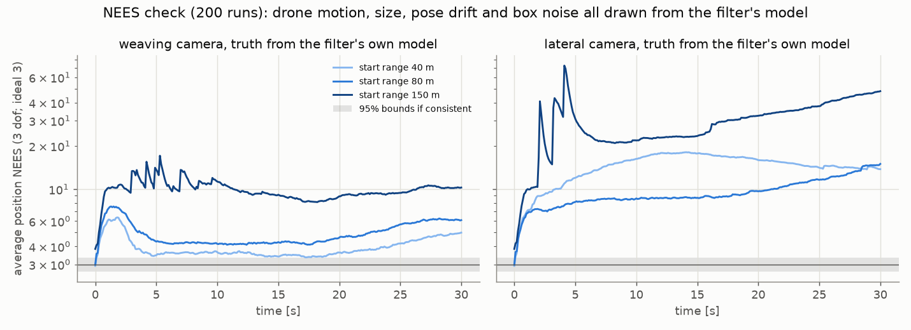

# drone-range-ekf

One-week project: **monocular drone detection plus an EKF that estimates a drone's 3D position,
velocity and range, with an honest range uncertainty, from a moving camera.**

* The **detector** (YOLO26s, Ultralytics) outputs a box. Its classes are `drone`, `bird`,
  `airplane` and `helicopter`; birds and aircraft are hard negatives.
* The box **centre** gives a bearing (through the camera intrinsics). The box **width** gives a
  range cue through `w_px = fx * S / Z`, where the drone's real size S is only known as a prior,
  N(0.35 m, 0.15² m²).
* The **camera pose** comes from simulated GPS/INS (truth + slowly drifting error + jitter).
* The **EKF** (hand-written NumPy, iterated update) estimates position, velocity, S and the
  GPS/INS drift.
* **Evaluation** of range is a NumPy simulation with ground truth (200 Monte Carlo runs per
  configuration). The detector's measured box noise drives the simulated detections.

> **Read this first.** Range accuracy is **simulation-only**. The Det-Fly results are
> **preliminary** (1,000 of 13,271 images). Latency is **desktop-GPU** (RTX 3080) latency.
> The filter is **not consistent in every case**: with a camera that does not manoeuvre, it reports
> a range σ several times smaller than its real error (see [Results](#results) and [Limitations](#limitations)).

`STUDY.md` explains every component and the math from scratch, the problems found along the way,
and 25 likely questions with answers.

## Results

All numbers below come from committed JSON/markdown files: `experiments/detector_results.md`
(detector) and `experiments/results_sim.md` (simulation, every configuration). Nothing is tuned
per table.

### Detector (YOLO26s, imgsz 1280)

Training: 10,200 images (drones 51%), stopped early at epoch 106 (best epoch 76) after 6.0 h.

| test set | P | R | mAP50 | mAP50-95 |
|---|---|---|---|---|
| DUT Anti-UAV test, drone (in-domain, 2,245 drones) | 0.987 | 0.967 | 0.979 | 0.749 |
| COCO + Open Images test, bird | 0.816 | 0.591 | 0.664 | 0.449 |
| COCO + Open Images test, airplane | 0.914 | 0.767 | 0.856 | 0.684 |
| COCO + Open Images test, helicopter | 0.949 | 0.903 | 0.944 | 0.759 |
| **Det-Fly, PRELIMINARY** (1,000 of 13,271 images, one sequence; cross-dataset) | 0.842 | **0.285** | **0.304** | 0.119 |

* **Det-Fly is a failure case.** Recall drops from 0.97 (DUT) to 0.29. The missed frames show the
  drone from above against farmland, roads and a sports field, or against a dark hillside at
  dusk. DUT drones are mostly against sky. Box size is not the cause: Det-Fly drones are
  ~46 px wide at 1280 input, and the missed ones are not smaller than the detected ones.
* **False drones** on 1,534 held-out bird/airplane/helicopter images: 5 at conf ≥ 0.25 (0.33% of
  images), 1 at conf ≥ 0.5. These are mostly ordinary photos, not distant birds against sky,
  so this probably understates the real false-alarm rate.
* **Latency, DESKTOP GPU (RTX 3080)**, batch 1, 1920×1080 frame, end-to-end `predict()`:

  | backend | mean ms | FPS |
  |---|---|---|
  | PyTorch FP16 | 5.4 | 187 |
  | PyTorch FP32 | 7.0 | 142 |
  | ONNX Runtime (CUDA) FP16 | 8.0 | 124 |
  | ONNX Runtime (CUDA) FP32 | 11.1 | 90 |

  ONNX Runtime was slower than PyTorch here. TensorRT and embedded hardware were not measured.
  The ONNX rows really ran on the GPU: the session's active providers were
  `['CUDAExecutionProvider', 'CPUExecutionProvider']` (`detector/check_onnx_providers.py`,
  `experiments/onnx_providers_*.json`). **Caveat:** that only works because torch is imported
  first and loads the CUDA 13 libraries. A process that imports onnxruntime alone silently
  falls back to CPU (~110 ms) in this venv. The "No registered plugin EP device" warning in
  the log does not indicate a CPU fallback.

**Real box errors** (matched true positives, DUT test, 2,196 of 2,245 drones matched), which
drive the simulator. Pixels are rescaled to the simulator's 1920-wide frame:



Centre σ ≈ 0.9 px for 16-32 px boxes (2.9 px above 160 px); width σ (log ratio) ≈ 0.09 at
16-24 px, ≈ 0.05 at 32-96 px. Real errors have heavier tails than a Gaussian (0.4-14% of centre
errors and 4-13% of width errors beyond 3 robust σ, vs 0.3% for a Gaussian). DUT has almost no drones under 16 px, so for 4-16 px boxes (≈ 55-200 m for a 0.35 m
drone) the simulator uses its default curves, scaled to the measured 16-24 px bin.

### Range EKF (SIMULATION ONLY, 200 Monte Carlo runs per row)

Scenario: the drone approaches from 200 m to 10 m and recedes; the camera flies straight
toward it, sideways, or weaves (±15 m, 12 s period). True drone size ~ N(0.35, 0.15²), except
the *wrong prior* rows (true 0.60 m, prior 0.35 ± 0.15). "Coverage" = fraction of time steps
with |error| ≤ 2σ (ideal 95%). "Range ANEES" ideal 1 (95% band [0.81, 1.21]).
**All rows are averaged over the time steps that did not crash:** in some runs the filter
state becomes NaN (failure 8 below), and the metrics leave those steps out.

| camera | size information | RMS range error | reported σ / range | 2σ coverage | range ANEES |
|---|---|---|---|---|---|
| straight | bearing only | 135% | 9.3% | 22% | 26.8 |
| straight | prior 0.35 ± 0.15 | 42% | 6.7% | 33% | 23.4 |
| straight | prior 0.35 ± 0.03 | 11% | 6.0% | 71% | 3.5 |
| straight | wrong prior (true 0.60) | 29% (bias -27%) | 5.9% | 3% | 47.7 |
| lateral | prior 0.35 ± 0.15 | 45% | 6.8% | 36% | 41.6 |
| lateral | wrong prior (true 0.60) | 30% (bias -28%) | 5.9% | 3% | 59.9 |
| **weaving** | bearing only | 321% (outliers; 68th pct 9%) | 6.2% | 90% | 52.0 |
| **weaving** | prior 0.35 ± 0.15 | **12.5%** | 3.7% | 78% | 3.9 |
| **weaving** | prior 0.35 ± 0.03 | **4.0%** | 3.7% | **95%** | **1.07** |
| **weaving** | wrong prior (true 0.60) | 9.7% (bias -8%) | 3.3% | 40% | 13.0 |



The shaded band is what the filter *claims* (±2σ); the dashed lines are the actual central 95%
of errors. With a weaving camera they nearly agree. With straight or lateral motion the actual
errors are far wider than the claimed band: **the filter is overconfident.**



Weaving camera with the 0.35 ± 0.15 prior: ~6% RMS out to 80 m, 13% at 80-120 m, 31% at
120-160 m and 67% at 160-200 m (the drone is 4-5 px wide there).





### What failed or is inconsistent (not hidden)

1. **Non-manoeuvring camera → overconfident filter.** Straight or lateral at constant velocity,
   range is not observable beyond the size prior (a scale ambiguity; shown by a unit test with
   perfect data). The *error* (~42-45% RMS) is what the prior allows, but the filter reports
   σ ≈ 7%, with 33-36% coverage. The cause is spurious information from box-width noise in the
   linearisation (same mechanism as EKF-SLAM inconsistency). Not fixed; see STUDY.md §8.4.
2. **Wrong size prior.** A 0.60 m drone with a 0.35 m prior: straight-on, range stays 27% short
   while the filter claims ±6% (3% coverage). Weaving learns S (final 0.58 m) but coverage is 40%.
3. **Long range is inconsistent even when the truth follows the filter's model** (experiment E,
   weaving): position ANEES 3.9 / 4.8 / 10.0 at 40 / 80 / 150 m (ideal 3).

   
4. **Plain (non-iterated) EKF** (experiment C): RMS 61-146%, 91-97% of runs end outside 3σ.
5. **Stress tests (experiment D).** White GPS noise, a filter that wrongly assumes white pose
   noise, and near-perfect pose sensors (1 cm, 0.01°) all break the straight-on case badly
   (range ANEES 500-1800). More precise sensors making consistency *worse* points at the
   Cartesian parameterisation, not the sensors.
6. **Partial fix that was tried:** inflating the assumed width noise ×2 (experiment F) brings
   weaving coverage from 78% to 92% (RMS 12.5% → 11.5%), but straight-on only goes from 33% to
   44% and its RMS gets worse. A Gaussian-sum bank over sizes made things worse (STUDY.md §8).
7. **Detector:** Det-Fly recall 0.29 (above), and the weakest class is bird (R 0.59).
8. **Some runs crash to NaN, and the tables hide them.** In 321 of 9,600 simulated runs, an
   iterated-update step put the drone estimate behind the camera (Z < 0), log Z became NaN,
   and the state stayed NaN. The metrics use `nanmean`, so those time steps are left out, and
   "final outside 3σ" counts a NaN run as not diverged. Main grid with the 0.35 ± 0.15 prior:
   7 (straight), 4 (lateral) and 14 (weaving) of 200 runs; weaving's "final outside 3σ" is
   4.5% as reported and 11.5% if NaN runs count as diverged. White-pose stress test: 147 of
   200, 20.5% → 94%. Full list: `experiments/nan_runs.md`. Not fixed (STUDY.md §5.5, §8.6).

## Layout

```
data/                (git-ignored) raw downloads and YOLO-format datasets (see DATA.md)
scripts/             data download/conversion, stats, sanity plots, rebalance_train.py
detector/            train.py, eval.py, false_positives.py, measure_noise.py, export_onnx.py,
                     latency.py, summarize.py, run_eval_all.sh, presentation_examples.py,
                     confusion_matrix_conf.py
sim/                 camera.py (pinhole), trajectories.py (drone/camera paths), noise.py (detector + GPS/INS noise)
ekf/                 ekf.py (13-state iterated EKF), nees.py (NEES / NIS / chi-square bounds)
experiments/         mc.py (one Monte Carlo run), run_experiments.py, make_figures.py,
                     try_size_bank.py (negative result); result JSON/markdown files
tests/               pytest: camera round trip, Jacobians vs finite differences, convergence,
                     unobservability, NEES consistency
figures/             result figures (figures/sanity/ is git-ignored)
presentation_assets/ slide images: training plots, example detections and misses (README.txt)
runs/                (git-ignored) training runs, logs, simulation arrays
```

## Reproduce

All commands run from the repo root with the venv active. Scripts that read downloaded data run
with `python -I` (isolated mode, so nothing in the data directories can be imported).

### 1. Environment (tested: Ubuntu, Python 3.12, RTX 3080 12 GB, driver 580 / CUDA 13.0)

```bash
python3 -m venv .venv && source .venv/bin/activate
pip install --upgrade pip
pip install torch==2.14.1 torchvision --index-url https://download.pytorch.org/whl/cu130
pip install -r requirements.txt
pip install pytest
python -c "import torch; print(torch.cuda.is_available(), torch.cuda.get_device_name(0))"
```

### 2. Data (about 13 GB in data/raw; licenses and manual steps in DATA.md)

```bash
# DUT Anti-UAV (Google Drive, official links)
mkdir -p data/raw/dut_anti_uav/zips && (cd data/raw/dut_anti_uav/zips && \
  for id in 1RVsSGPUKTdmoyoPTBTWwroyulLek1eTj 1333uEQfGuqTKslRkkeLSCxylh6AQ0X6n 1L1zeW1EMDLlXHClSDcCjl3rs_A6sVai0; do gdown "$id"; done)
mkdir -p data/raw/dut_anti_uav/extracted && for z in data/raw/dut_anti_uav/zips/*.zip; do unzip -q -o "$z" -d data/raw/dut_anti_uav/extracted; done
python -I scripts/convert_dut.py

# COCO bird/airplane (annotations zip, then per-image download)
mkdir -p data/raw/coco/zips && aria2c -x8 -d data/raw/coco/zips http://images.cocodataset.org/annotations/annotations_trainval2017.zip
python -I scripts/download_coco_subset.py

# Open Images V7 helicopter/bird/fixed-wing aircraft
mkdir -p data/raw/openimages/csv && cd data/raw/openimages/csv && \
  for u in https://storage.googleapis.com/openimages/v6/oidv6-train-annotations-bbox.csv \
           https://storage.googleapis.com/openimages/v5/validation-annotations-bbox.csv \
           https://storage.googleapis.com/openimages/v5/test-annotations-bbox.csv \
           https://storage.googleapis.com/openimages/v7/oidv7-class-descriptions-boxable.csv \
           https://storage.googleapis.com/openimages/2018_04/bbox_labels_600_hierarchy.json; do aria2c -x8 "$u"; done; cd -
python -I scripts/download_openimages_subset.py

# Det-Fly (held-out test). Provisional partial copy (1,000 images) from Hugging Face; full set = manual (DATA.md §3)
mkdir -p data/raw/detfly/zips && aria2c -x8 -d data/raw/detfly/zips -o Det-Fly.zip \
  https://huggingface.co/datasets/DestinyLove/Det-Fly/resolve/main/Det-Fly/Det-Fly.zip
mkdir -p data/raw/detfly/extracted && unzip -q -o data/raw/detfly/zips/Det-Fly.zip -d data/raw/detfly/extracted
python -I scripts/convert_detfly.py

# Data YAMLs, then the rebalanced training list (drones ~51% of training images)
python -I scripts/make_data_yaml.py
python -I scripts/rebalance_train.py        # -> data/yolo/drone4_bal.yaml, experiments/train_balance_stats.json
```

Drone-vs-Bird was not used (its videos need a signed agreement, see DATA.md §2).

Data checks: `python -I scripts/sanity_check.py --n 8` (GT box images in figures/sanity/),
`python -I scripts/dataset_stats.py` (figures/dataset_stats.{md,json}), `python detector/train.py --smoke`
(1-epoch GPU smoke test).

### 3. Detector

```bash
# training: 7 h time budget, early stopping (patience 30), in tmux so it survives a disconnect
tmux new -s train "python detector/train.py --data data/yolo/drone4_bal.yaml --model yolo26s.pt --imgsz 1280 \
    --epochs 150 --batch 8 --workers 12 --time 7 --patience 30 --name drone4_bal 2>&1 | tee runs/logs/train_drone4_bal.log"
python detector/train.py --resume --name drone4_bal        # only if it was interrupted

# evaluation: accuracy (DUT, all classes, Det-Fly partial), false positives, box noise, ONNX export, latency
bash detector/run_eval_all.sh runs/detect/drone4_bal/weights/best.pt
```

Outputs: `experiments/eval_{dut_test,all4_test,detfly_partial}.json`, `experiments/false_positives.json`,
`experiments/detector_noise.json` (read by `sim/noise.py`), `experiments/latency.json`,
`experiments/detector_results.md`, `figures/detector_noise.png`.

### 4. Simulation, EKF, tests, figures

```bash
python -m pytest -q                                   # 12 tests, ~5 s
python experiments/run_experiments.py                 # all configurations x 200 runs, ~2-3 min on 8 cores
python experiments/make_figures.py                     # figures/*.png
python experiments/check_nan_runs.py                  # runs whose state became NaN -> experiments/nan_runs.md
python experiments/try_size_bank.py straight 0.02     # optional: the negative result in STUDY.md §8
python detector/check_onnx_providers.py               # optional, needs the exported ONNX model
```

**Checked from a fresh clone (2026-11-19):** cloning the GitHub repo into an empty directory,
installing as in step 1, then running `pytest`, `run_experiments.py` and `make_figures.py` gives
12 passing tests and a
`results_sim.md`/`results_sim.json` and figures that are **byte-identical** to the committed
ones. All randomness is seeded (`seed = 1000 + run index`), so there is no Monte Carlo
variation between reruns. `figures/detector_noise.png` is not regenerated by these commands
(it needs the dataset and the trained weights).

**How lenient the NEES unit test is:** `test_nees_consistent_when_model_matches` runs 60
Monte Carlo runs of a weaving camera with the truth drawn from the filter's own model, averages
the 3-dof position NEES over t = 15-30 s, and passes if the result is between 1.5 and 6.0
(a factor 2 around the ideal 3). It currently measures **4.71**. A consistent filter would
land in [2.41, 3.65] (95% band for 60 runs), so a strict consistency test would **fail**.
The test is a regression guard (the plain EKF scores 89.9 and fails it), not a proof of
consistency.

Outputs: `experiments/results_sim.{json,md}`, `runs/sim/*.npz` (git-ignored), `figures/*.png`.
The simulation uses `experiments/detector_noise.json` if present (it is committed), otherwise
documented default noise curves.

## Limitations

Every assumption, in one place:

* **Range accuracy is simulation-only.** No real flights, no hardware, no synchronised video +
  GPS/INS, and no ground-truth range. All range numbers come from the NumPy simulation.
* **Camera pose is "known" from simulated GPS/INS.** It is truth plus a Gauss–Markov drift
  (1.5 m, 0.5°) plus small jitter. Real GPS/INS errors (multipath, time-sync offsets between
  camera and INS, lever arms, rolling shutter) are not modelled. Camera intrinsics are assumed
  perfectly calibrated with no lens distortion.
* **Single target, no clutter.** Every simulated detection belongs to the one drone. There is no
  gating, no data association and no false-positive injection into the filter. The detector's
  false-drone rate on birds/aircraft is measured, but it is not fed to the EKF.
* **Simulated detector noise is Gaussian.** Its σ vs box size (and the detection rate) come from
  the real detector on DUT test images (robust σ), but the real errors have heavier tails (tail
  fractions are in `experiments/detector_results.md`), and errors are independent from frame to
  frame in the simulation (real ones are correlated). The calibration is on one dataset (DUT),
  and DUT has almost no drones under 16 px, so the long-range noise (4-16 px) is extrapolated.
* **Apparent size = fx·S/Z.** Real apparent size depends on drone orientation, propeller blur
  and how tight the boxes are. Here, a measured median log-width bias is ignored in the
  simulator, and S is a single Gaussian prior (0.35 ± 0.15 m) that cannot represent "it is
  either a small quadcopter or a large one".
* **The EKF is not consistent in every case.** With a non-manoeuvring camera (straight-on or
  lateral at constant velocity), range is unobservable beyond the size prior, and the Cartesian
  EKF reports a σ several times smaller than its real error. The same happens with near-perfect
  pose sensors. Not fixed; remedies are listed in STUDY.md §8.
* **The filter can crash to NaN** when an update step puts the drone behind the camera
  (3.3% of all simulated runs); the reported metrics exclude those time steps.
* **Constant-velocity motion model.** The simulated drones fly constant velocity or gentle turns;
  aggressive manoeuvres are not tested.
* **Det-Fly results are preliminary.** Only 1,000 of 13,271 images (one sequence) were available;
  4K frames are downscaled. Drone-vs-Bird was not used (signed agreement needed).
* **Latency is desktop-GPU latency** (RTX 3080, batch 1). Embedded hardware will be slower.

## Data

See DATA.md for sources, licenses, counts and manual steps.
